<div align="center">

# Toolverse

**One workspace, a universe of AI tools.**

Write articles, brainstorm blog titles, generate images, remove backgrounds and objects, and get your resume reviewed, all in one place, with everything you make saved, searchable and shareable.

**Live demo: [toolverse.yusufhussain.in](https://toolverse.yusufhussain.in)**

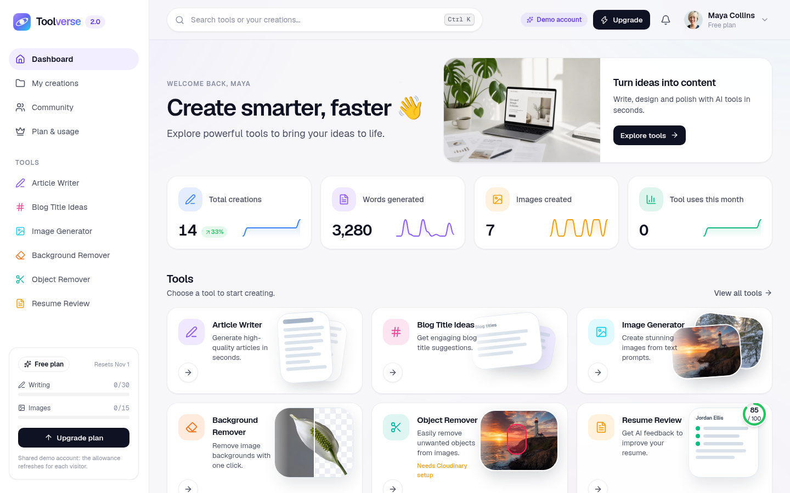

</div>

## What's new in 2.0

Toolverse started as a course project ("QuickAI"). 2.0 is a rebuild:

| Area | 1.0 | 2.0 |
|---|---|---|
| Getting started | Needed Neon, Clerk, Gemini, ClipDrop and Cloudinary keys just to boot | Runs every tool except object removal with **no AI keys**; better providers switch on when their keys are set |
| AI | Gemini only, raw prompts from the browser | **Claude** (Opus 5.5 via the official SDK), OpenAI, Gemini or a free provider for text; OpenAI `gpt-image-2`, ClipDrop or a free provider for images; prompts built on the server |
| Design | White template with a blue gradient | Premium workspace: dashboard with stats and charts, Ctrl K search, notifications, light and dark themes, phone layout |
| Features | Six forms and a list | Tool pages with live progress and history, a creations library, a community gallery with likes, plan and usage |
| Security | `requireAuth()` redirects on API calls, usage counters in Clerk metadata, likes on any id | Verified sessions, owner-scoped queries, atomic monthly quotas, signed file URLs, **36 automated security checks** |
| Data | Empty | `npm run seed`: a demo account with 14 creations, three more creators and community likes |

## Features

- **Article Writer**: topic, length (short / medium / long) and tone (informative, conversational, professional, persuasive); Markdown with headings, lists and tables
- **Blog Title Ideas**: ten titles in mixed styles for a topic and category, each one quick to copy
- **Image Generator**: prompt, 8 styles, square / landscape / portrait, optional sharing to the community
- **Background Remover**: drop or paste a photo, get a transparent PNG with a before/after slider
- **Object Remover**: name something in a photo and it disappears (Cloudinary generative remove)
- **Resume Review**: upload a PDF and an optional target role; get a score out of 100, strengths, fixes, missing keywords and a rewritten summary
- **Dashboard**: total creations with week-over-week change, words generated, images created and tool uses with 14-day sparklines, illustrated tool tiles, recent creations with actions, and a creations-per-day chart (7, 14 or 30 days)
- **Search (Ctrl/Cmd + K)** across tools, pages and your own creations
- **Notifications** when someone likes an image you shared
- **My creations**: filter by tool, search, open any result in a side panel, copy or download (.md or image), share or delete
- **Community**: masonry gallery of shared images, newest or most liked, optimistic likes, large viewer
- **Plan & usage**: monthly writing and image allowances with the reset date, counts per tool, and which AI engine runs each tool
- **Polish**: skeletons, empty states, toasts, focus styles, `prefers-reduced-motion`, 390 px phones to wide desktops, light (default) and dark themes

## Screenshots

| | |
|---|---|
| 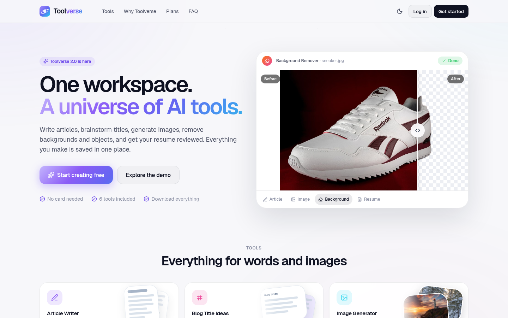 | 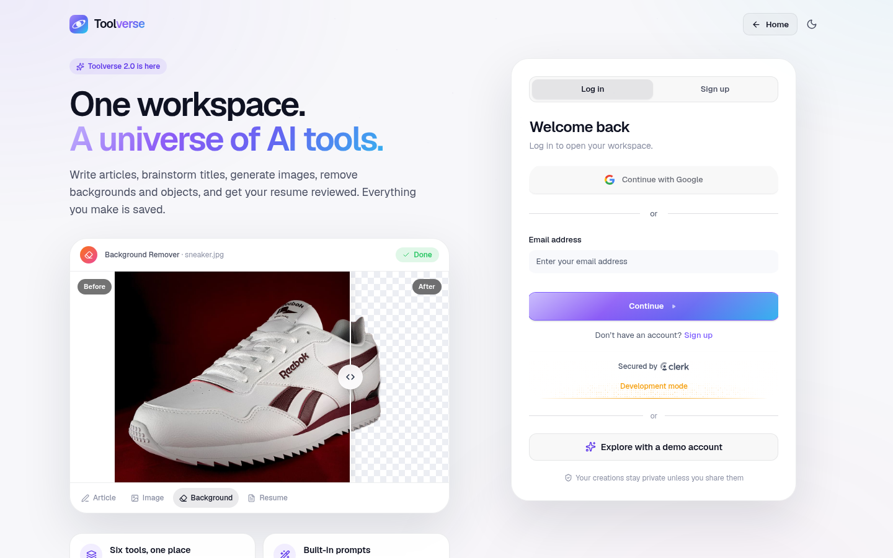 |
| Landing page with a live tool preview | Sign in, or explore with the demo account |
| 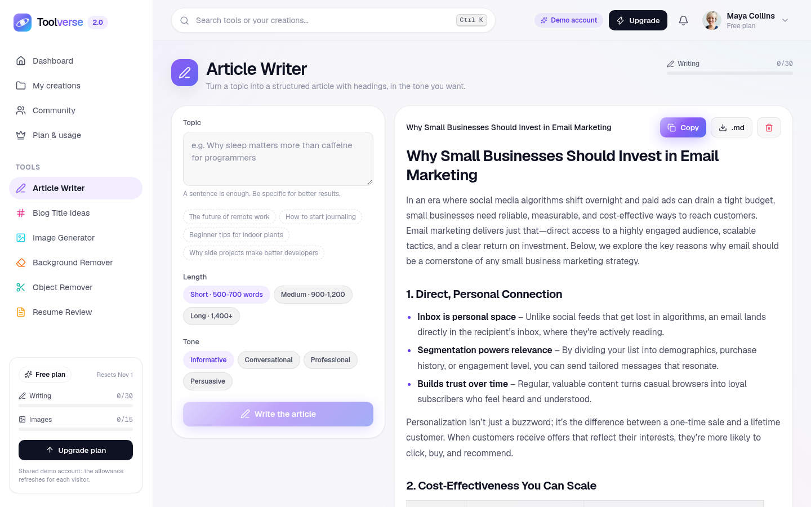 | 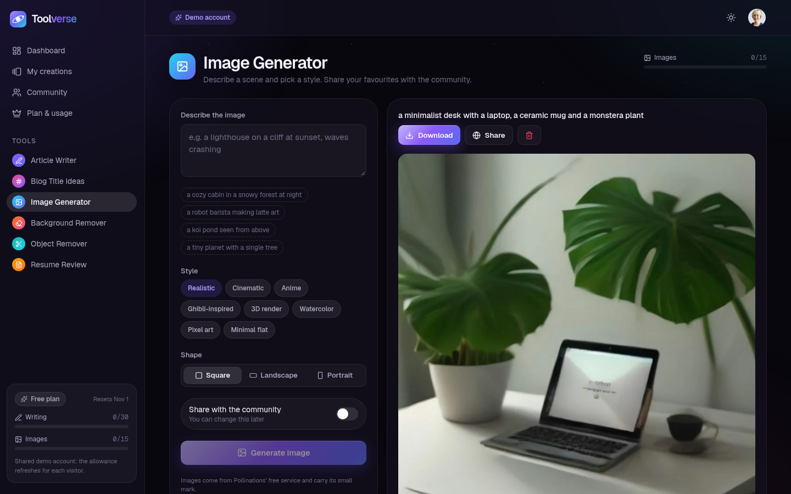 |
| Article writer (Claude) | Image generator |
| 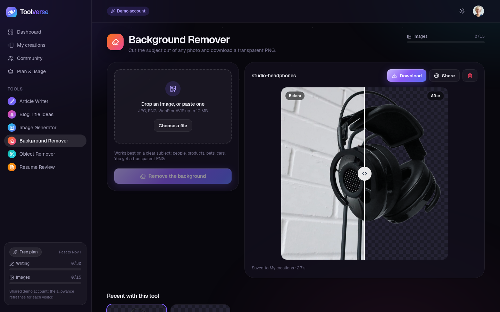 | 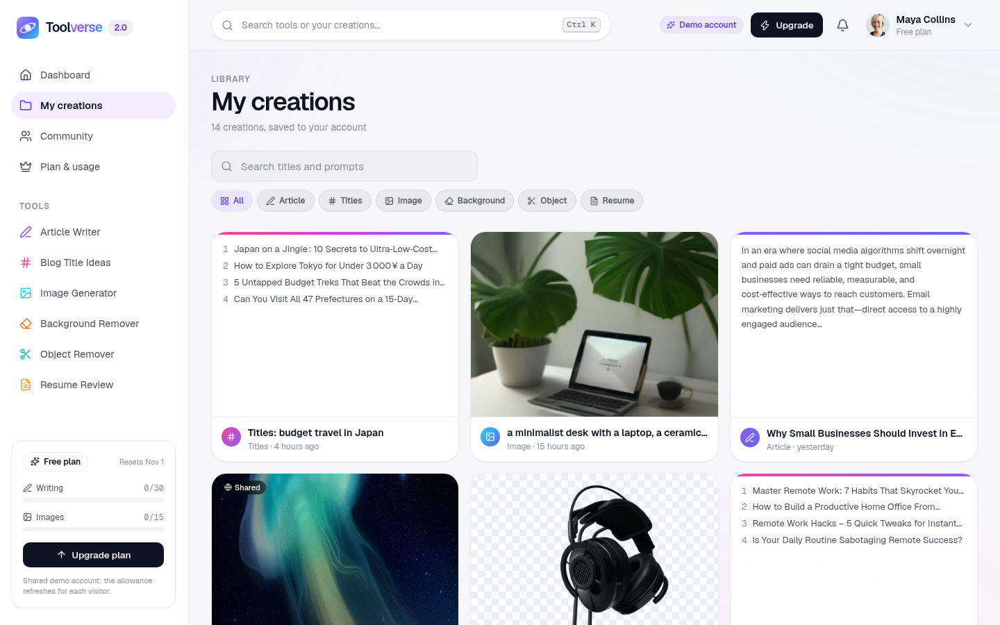 |
| Background remover with before/after | My creations |
| 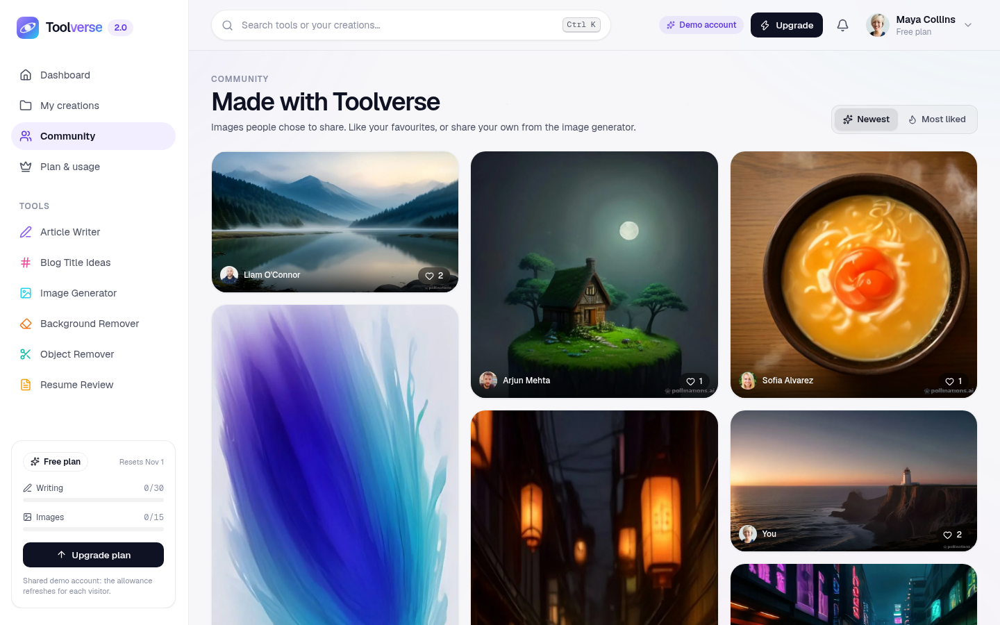 | 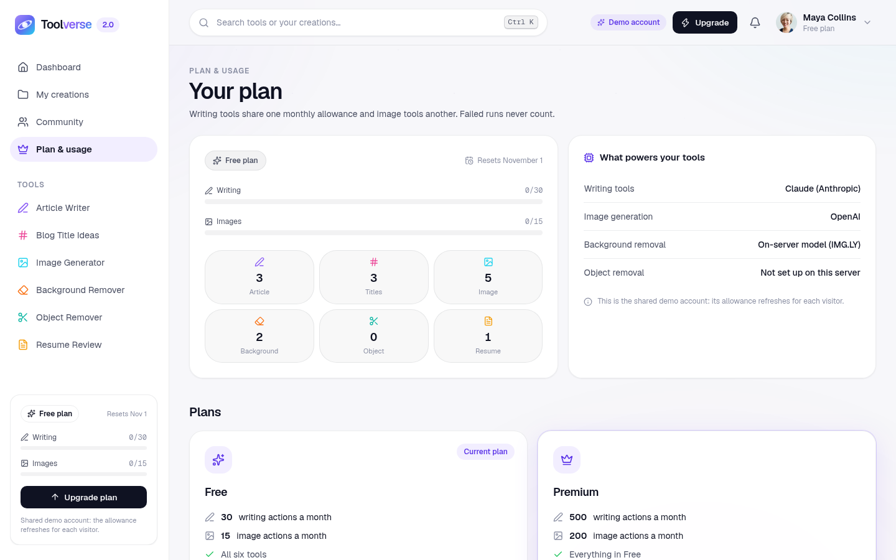 |
| Community gallery | Plan & usage |
| 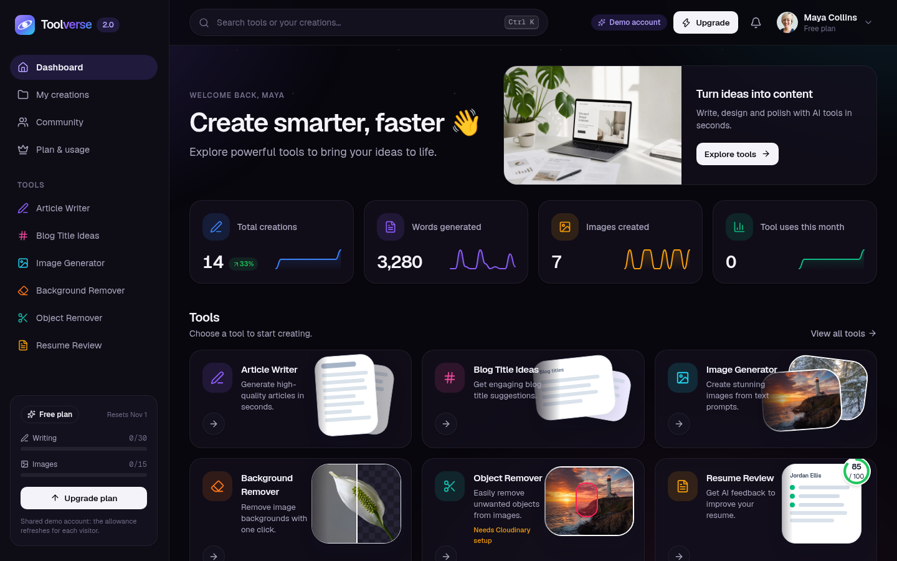 | |
| Dark theme | |

<p align="center">
  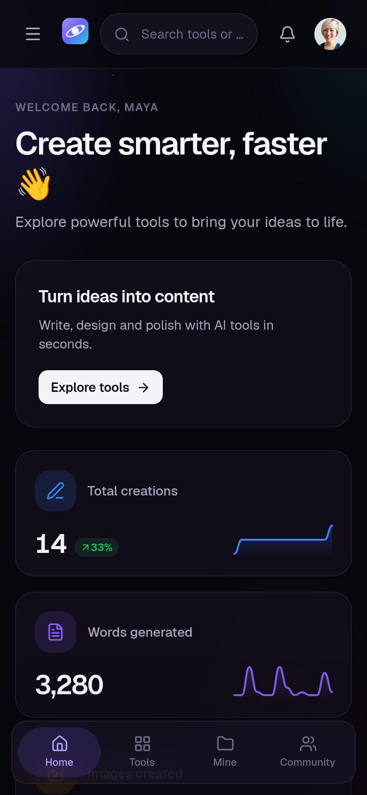
  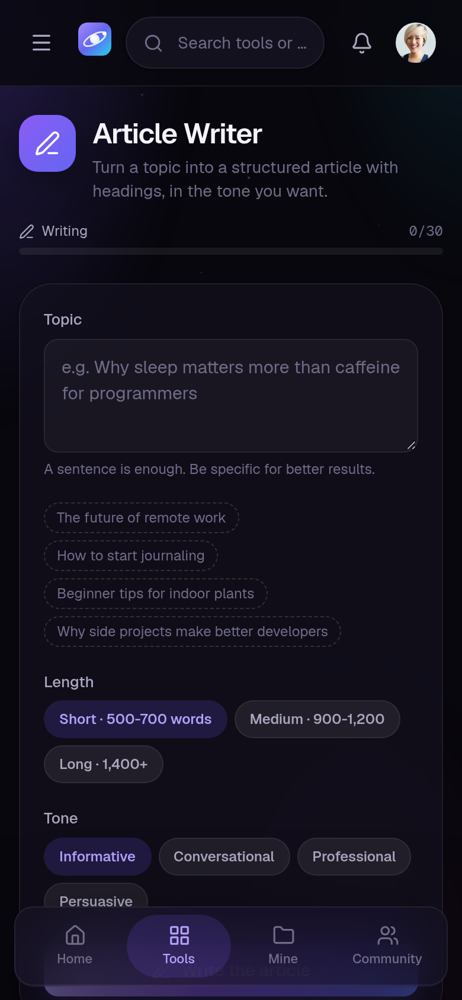
  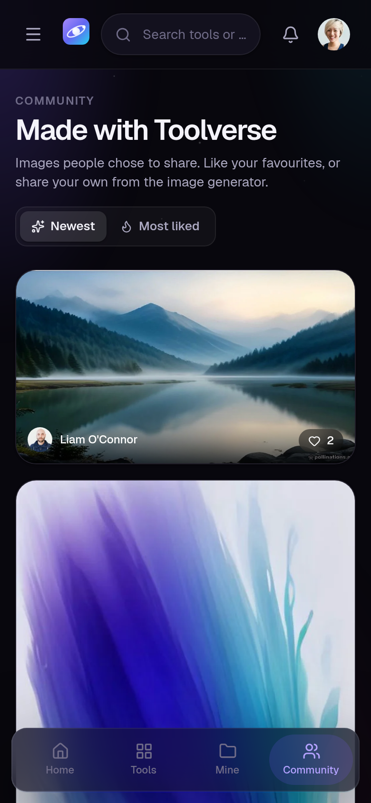
</p>

## Tech stack

| Part | Tech |
|---|---|
| Client | React 19, Vite 8, React Router 7, Tailwind CSS 4, lucide-react, react-markdown, react-hot-toast |
| Auth | Clerk (`@clerk/react` in the browser, `@clerk/express` on the API) |
| API | Node.js, Express 5, multer, sharp, unpdf |
| Database | Postgres on [Neon](https://neon.tech) (`pg`), schema in `server/db/schema.sql` |
| Text AI | Claude via `@anthropic-ai/sdk`, OpenAI, Google Gemini, or Pollinations (free) |
| Image AI | OpenAI `gpt-image-2`, ClipDrop, or Pollinations (free); IMG.LY background removal; Cloudinary generative remove |

## Project structure

```
toolverse/
├── client/                    # React app (Vite)
│   ├── public/samples/        # Sample images used by the landing page and dashboard
│   └── src/
│       ├── pages/             # Landing, Auth, Dashboard, Tools, Library, Community, Plan, NotFound
│       │   └── tools/         # WriteArticle, BlogTitles, GenerateImage, RemoveBackground, RemoveObject, ReviewResume
│       ├── components/
│       │   ├── ui/            # Logo, Avatar, Modal, EmptyState, CompareSlider, ScoreRing, Sparkline, Loader
│       │   ├── tools/         # ToolShell, FileDrop, form fields
│       │   ├── creations/     # CreationCard, CreationViewer
│       │   ├── dashboard/     # LineChart, ToolArt, ActivityChart
│       │   ├── marketing/     # ToolPreview
│       │   └── AppLayout, CommandPalette, HeaderMenus, UsageMeter
│       ├── hooks/             # account, tool runs, creation actions, theme, dismiss
│       ├── lib/               # tools catalogue, creations helpers, theme, format, image downscaling before upload
│       └── index.css          # design tokens and primitives
├── api/index.js               # Vercel function that serves the Express app
├── vercel.json                # build, rewrites, region and the model files bundled with the function
└── server/                    # Express API (app.js builds the app, server.js listens locally)
    ├── lib/                   # ai (text providers), claude (Anthropic SDK), images (generation, removal, storage), quota
    ├── controllers/ routes/   # tools, creations, community, me, notifications, demo, Clerk webhook
    ├── db/schema.sql          # users, assets, creations, likes, usage
    └── scripts/               # migrate.mjs, seed.mjs, security-test.mjs, samples/
```

## Getting started

### Prerequisites

- Node.js 20.9+
- A Postgres database: a free [Neon](https://neon.tech) project, or local Postgres
- A free [Clerk](https://dashboard.clerk.com) application with Email (password on) and Google sign-in

### 1. Clone and install

```bash
git clone https://github.com/Yusuf-Hussain25/toolverse.git
cd toolverse
npm install          # root tools (concurrently)
npm run install:all  # server + client
```

The server's `.npmrc` skips onnxruntime's 400 MB CUDA download; the background-removal model runs on the CPU.

### 2. Configure

```bash
cp server/.env.example server/.env
cp client/.env.example client/.env
```

| File | Key | Where to find it |
|---|---|---|
| `server/.env` | `DATABASE_URL` | Neon → your project → **Connect** → connection string |
| `server/.env` | `CLERK_PUBLISHABLE_KEY`, `CLERK_SECRET_KEY` | Clerk → **Configure → API keys** |
| `server/.env` | `ANTHROPIC_API_KEY`, `OPENAI_API_KEY`, `GEMINI_API_KEY` | Optional, see [Configurable providers](#configurable-providers) |
| `server/.env` | `CLOUDINARY_*` | Optional, turns on object removal |
| `server/.env` | `DEMO_EMAIL`, `DEMO_PASSWORD`, `SEED_PASSWORD` | Your choice; used by `npm run seed` |
| `client/.env` | `VITE_CLERK_PUBLISHABLE_KEY` | Same publishable key |
| `client/.env` | `VITE_API_URL` | `http://localhost:3000` |
| `client/.env` | `VITE_DEMO_EMAIL` | Optional. Shows "Explore with a demo account" |

`.env` files are git-ignored. Only `VITE_` values reach the browser; AI keys and secrets stay on the server. Missing required keys produce a readable message (API) or a setup screen (client) instead of a crash.

### 3. Create the tables and run

```bash
npm run migrate   # creates the tables (safe to re-run)
npm run dev       # API on :3000, client on :5173
npm run seed      # in a second terminal: demo data through the running API
```

Open http://localhost:5173 and click **Explore with a demo account**.

## Configurable providers

| Setting | What it does |
|---|---|
| Text: `ANTHROPIC_API_KEY` | Claude (`claude-opus-5-5`, override with `CLAUDE_MODEL`) through the official SDK, with adaptive thinking (effort low for titles, medium for articles, high for resume reviews) and the server-side refusal fallback |
| Text: `OPENAI_API_KEY` / `GEMINI_API_KEY` | Used when no Claude key is set (in that order); `OPENAI_MODEL`, `GEMINI_MODEL` pick the model |
| Text: none | Pollinations' free endpoint. Requests are queued about 30 s apart (its per-IP limit) and retried once; long articles can be cut short |
| `TEXT_PROVIDER` | Force `anthropic`, `openai`, `gemini` or `pollinations` |
| `IMAGE_PROVIDER` | `pollinations` (default, free, small Pollinations mark), `openai` (`gpt-image-2`, no mark, paid per image; `OPENAI_IMAGE_QUALITY` low/medium/high) or `clipdrop` (`CLIPDROP_API_KEY`) |
| `BG_PROVIDER` | `local` (default): IMG.LY's open-source model inside the API, free. `cloudinary`: Cloudinary's background removal add-on |
| `CLOUDINARY_*` | Turns on object removal. Without it, the tool explains what's needed and never uses your allowance |
| `FREE_TEXT_LIMIT`, `FREE_IMAGE_LIMIT` | Monthly free allowance (30 / 15). Users on a Clerk Billing plan named `premium` get 500 / 200 |

## Security

`npm run test:security` (API running) creates two throwaway Clerk users and checks 36 rules against the real API, then deletes them:

- requests without a session or with a forged token are rejected (401)
- users can't read, publish, delete or list each other's creations
- file links are signed per file and expire; links for another file, tampered or expired links are refused
- unpublished creations can't be liked; concurrent likes never duplicate; only images can be published
- the community shows authors' names and photos, never ids or emails
- bad input and unconfigured tools never use the allowance; three parallel requests with one action left: exactly one succeeds and usage never exceeds the limit
- unsigned Clerk webhooks are refused; deleting a creation deletes its files

How it's enforced: every `/api` route verifies the Clerk session (`clerkMiddleware` + `getAuth`); creations are always queried by `owner`; quotas are taken with one `INSERT … ON CONFLICT … WHERE count < limit` and refunded if a tool fails; likes are a `(creation, user)` table; files are served through HMAC-signed URLs. The shared demo account can't delete its samples, visitors' own creations there are cleared after a day, and its allowance refreshes on each demo sign-in once half is used.

## Demo data

```bash
npm run seed                          # demo account + 3 creators
npm run seed -- --with you@email.com  # also add a few creations to your own account
```

The seeder signs in as each account with a real Clerk session and creates everything through the API, so it goes through the same validation, AI providers and quotas as the app. The demo account (Maya Collins) gets 3 articles, 3 title lists, a resume review of a fictional sample resume, 5 generated images (4 shared) and 2 background removals spread over two weeks; three more creators on `@toolverse-demo.dev` share images, and everyone likes a few of each other's. It's safe to re-run: accounts are matched by email and items by prompt, and anything a busy provider refused is filled in next time.

| Account | Password |
|---|---|
| `DEMO_EMAIL` (Maya Collins) | `DEMO_PASSWORD`, or the one-click demo button |
| `arjun.mehta@`, `sofia.alvarez@`, `liam.oconnor@toolverse-demo.dev` | `SEED_PASSWORD` |

## Deployment

The live demo runs entirely on free tiers: the client and the API on **Vercel** (one project, `toolverse.yusufhussain.in`) and Postgres on **Neon**, both in Singapore. Every push to `main` deploys. Nothing has to be kept awake: Vercel doesn't sleep, and Neon wakes in under a second.

**One Vercel project for both**

1. Import the repo in Vercel and keep the **Root Directory** at the repo root. `vercel.json` installs both packages, builds the client into `client/dist`, serves `api/index.js` (the Express app) as a function in `sin1`, and rewrites every other path to `index.html`.
2. Add a database: Vercel → **Storage → Neon** (region Singapore), then run `npm run migrate --prefix server` once with its `DATABASE_URL`.
3. Environment variables: `CLERK_PUBLISHABLE_KEY`, `CLERK_SECRET_KEY`, `DEMO_EMAIL`, `ORIGINS` (your domain and `vercel.app` URL), `FILE_SIGNING_SECRET`, `DB_POOL_SIZE=3`, the providers, and for the client `VITE_CLERK_PUBLISHABLE_KEY`, `VITE_API_URL` (your domain) and `VITE_DEMO_EMAIL`.
4. Seed through the deployed API: `API_URL=https://… DATABASE_URL=… npm run seed --prefix server`.
5. In Clerk, add the production domain (**Configure → Domains**).

**Why it fits in a function:** the local background-removal model peaks at about 900 MB of memory, inside the 2 GB a Vercel function gets on the free plan. Its files (about 280 MB with the Linux onnxruntime binary) are bundled with `includeFiles`, which Vercel's large-functions support allows. Requests and responses are capped at 4.5 MB, so the browser scales photos over 3 MB down to 2048 px before uploading (the server resizes to 2048 px anyway), resumes are limited to 4 MB, and saved results are scaled down until they're under 4 MB.

**Free providers for a public demo:** `TEXT_PROVIDER=pollinations` and `IMAGE_PROVIDER=pollinations` need no key and cost nothing, so visitors can't run up a bill. A free `GEMINI_API_KEY` (Google AI Studio, no card) gives better text. Leave paid keys (Anthropic, OpenAI) out of a public deployment.

To run the API on a smaller Node host instead, set `BG_PROVIDER=cloudinary` so the local model isn't needed.

## Credits

- Sample product photos for background removal: Wikimedia Commons contributors under CC BY / CC BY-SA, listed in [`server/scripts/samples/CREDITS.md`](server/scripts/samples/CREDITS.md); the sample resume is fictional
- Profile photos for seeded accounts: [randomuser.me](https://randomuser.me)
- Background removal model: [IMG.LY background-removal-js](https://github.com/imgly/background-removal-js) (AGPL-3.0)

## Author

**Yusuf Hussain** · https://github.com/Yusuf-Hussain25
